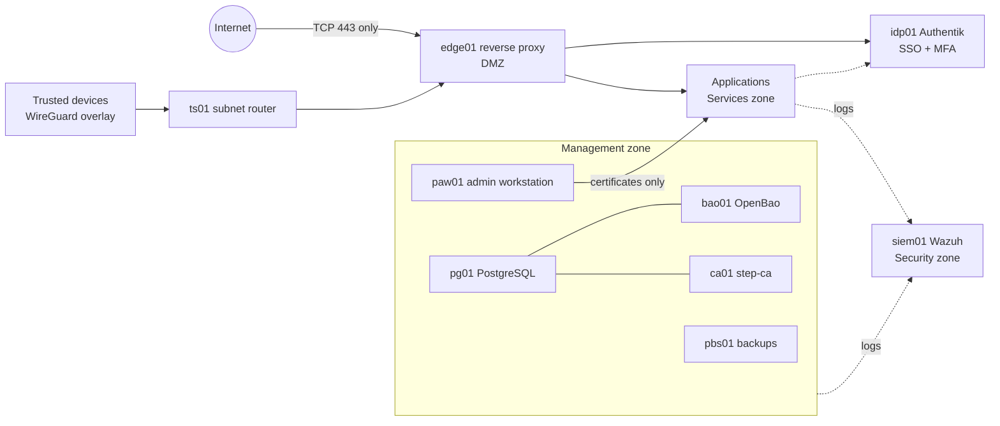

# labstack-infra

A self-hosted platform built and run the way a small enterprise would: infrastructure as code, tiered
secrets, short-lived certificates, identity-aware access, a SIEM with custom detections, tested recovery
procedures, and a control mapping to NIST and the common Top 10 lists.

This is the **sanitized public edition** of a live private environment. Code and documentation are real.
Addresses, names and credentials are not ([what was changed](#what-was-sanitized)).



## Stack

| Concern | Choice | Decision |
|---|---|---|
| Provisioning | OpenTofu with encrypted state in PostgreSQL | [ADR-0001](docs/adr/0001-opentofu-over-terraform.md), [ADR-0002](docs/adr/0002-tofu-state-in-postgresql.md) |
| Configuration | Ansible: roles shared across environments | [Architecture](docs/architecture/overview.md) |
| Virtualization | Proxmox VE cluster and a standalone lab node | [ADR-0005](docs/adr/0005-lab-node-and-paw.md) |
| Secrets | sops/age for tier 0, OpenBao for services | [ADR-0003](docs/adr/0003-openbao-for-secrets.md) |
| PKI and SSH | step-ca with short-lived certificates | [ADR-0004](docs/adr/0004-step-ca-for-certificates.md) |
| Machine and device identity | vTPMs, device certificates | [ADR-0006](docs/adr/0006-tpm-and-device-trust.md) |
| Segmentation | Zone policy plus hypervisor-enforced guest firewalls | [ADR-0007](docs/adr/0007-zone-segmentation-and-guest-firewalls.md) |
| Edge and SSO | Caddy, Authentik | [ADR-0008](docs/adr/0008-single-edge-and-central-identity.md) |
| Remote access | Headscale and Tailscale clients | [ADR-0009](docs/adr/0009-split-tunnel-overlay-vpn.md) |
| Detection | Wazuh | [ADR-0010](docs/adr/0010-wazuh-as-siem.md) |
| Backup | Proxmox Backup Server, ZFS snapshots, git mirrors | [ADR-0011](docs/adr/0011-backup-strategy.md) |
| Endpoints | Fleet MDM | [ADR-0012](docs/adr/0012-fleet-for-mobile-device-management.md) |

## Documentation

Everything is in **[docs/](docs/README.md)**:

| Section | Use it to |
|---|---|
| [Architecture](docs/architecture/overview.md) | understand the design |
| [ADRs](docs/adr/README.md) | see what was decided and why |
| [How-to guides](docs/howto/README.md) | build or change a component |
| [Runbooks](docs/runbooks/README.md) | respond when something breaks |
| [Admin walk-throughs](docs/admin/README.md) | do routine daily to yearly work |
| [Acceptance test procedures](docs/atp/README.md) | prove a control works |
| [Compliance mapping](docs/compliance/README.md) | trace controls to NIST, CIS and Top 10 lists |

## Repository layout

```
ansible/     roles, playbooks, inventories (prod, labnode, dev), network policy as data
tofu/        OpenTofu roots: envs, platform, openbao, authentik, cloud; reusable modules
bin/         wrappers that fetch credentials and run tools safely
fleet/       MDM configuration as code
config/      the placeholder list
scripts/     check-sanitized.sh, the publication guard
docs/        all documentation
```

## What was sanitized

| Original | Here |
|---|---|
| Private subnets | tokens such as `__MGMT_NET__.22` (the full list is in [placeholders.example.env](config/placeholders.example.env)) |
| Domain | `example.com` (RFC 2606) |
| Hardware or personally derived host names | `pve01`-`pve03`, `labnode` |
| People and accounts | `alice`, `bob`, `labadmin` |
| MAC addresses, public IPv6 in log samples | RFC 7042 and RFC 3849 documentation ranges |
| Encrypted secrets, certificates, TPM pins, SSH keys, raw host evidence | removed ([secrets/](secrets/README.md), [ansible/files/](ansible/files/README.md)) |
| Git history | not carried over |

Role-based names (`edge01`, `pg01`) are kept because they carry no identifying information and the code
and documentation depend on them. `scripts/check-sanitized.sh` runs as a pre-commit hook to keep it this way.

## Using it

The code will not run until placeholders have values and the excluded artifacts exist:

```bash
cp config/placeholders.example.env ~/placeholders.env   # then edit it
```

```bash
bin/render-placeholders ~/placeholders.env              # in a PRIVATE fork only
```

Then follow [Build the platform tier](docs/howto/platform-tier.md). Tools are pinned in `mise.toml`.
