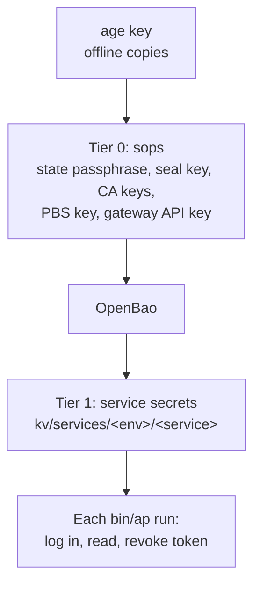
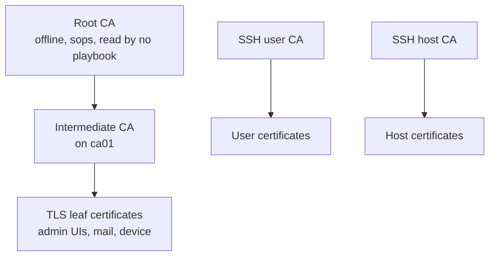

# Identity, secrets and PKI

## Identity types

| Identity | Authenticated by | Credential lifetime | Authorized by |
|---|---|---|---|
| Person, web | Authentik password plus TOTP or WebAuthn | Session | Authentik groups, per application |
| Person, SSH | `step ssh login` through Authentik | 16 h (max 24 h) | `ssh-admins` group and `ssh_ca_people` list |
| Ansible | JWK provisioner | 8 h (max 12 h) | Fixed principal `ansible` |
| OpenTofu | JWK provisioner | 8 h (max 12 h) | Fixed principal `tofu` |
| Host | Signed by the controller | 90 days, renewed at 30 left | Names in the inventory only |
| Device | OIDC with fresh MFA | 30 days | Key hash registered in OpenTofu |
| Break-glass | Offline signature from sops | 1 h (max 8 h) | Raises a level 12 alert |

Access decisions need two gates: **Authentik decides who gets a certificate; the inventory decides which
hosts accept it.**

## Secret tiers

| Tier | Store | Contents | Why here |
|---|---|---|---|
| 0 | sops/age in git | What builds or unlocks the platform, plus break-glass | OpenBao cannot hold the keys that open OpenBao |
| 1 | OpenBao | Database passwords, API tokens, OIDC client secrets | Audit log, per-identity policy, versioning |
| Device | TPM (`systemd-creds`) | Secrets for native services | Unreadable if the disk is copied |

`secrets/policy.yml` is the routing table: `sops_only` and `tofu_owned` are regexes over key names, read by
every tool that handles secrets. Rationale: [ADR-0003](../adr/0003-openbao-for-secrets.md).

**Machine policies**

| Identity | Can |
|---|---|
| `ansible` | Read `kv/services/*` |
| `tofu` | Read `kv/tofu/*` |
| `tf-authentik` | Write its own `kv/services/+/tf-authentik` path |

## Certificate hierarchy

Two step-ca instances share keys and a database:

| Instance | Port | Serves | Why separate |
|---|---|---|---|
| `step-ca` | 443 | Automation and hosts | Must keep working if the IdP is down, since it is needed to fix the IdP |
| `step-ca-login` | 8443 | People and devices | Will not start without an OIDC discovery document |

`pg01` keeps its own small CA because `ca01` depends on `pg01`, so `pg01` cannot depend on `ca01`.

Rationale: [ADR-0004](../adr/0004-step-ca-for-certificates.md),
[ADR-0006](../adr/0006-tpm-and-device-trust.md).

## Rollout states

Several controls roll out in stages so they can be observed before they can cause an outage. This repository
shows the following values:

| Switch | Location | Value | Meaning |
|---|---|---|---|
| `firewall_enforce` | `tofu/envs/prod/firewall.tf` | default `false` | Audit: logs what it would drop |
| `ssh_ca_enforce` | `inventories/common/group_vars/all/ssh_ca.yml` | `false` | Certificates work, static automation keys remain |
| `device_trust` / `device_trust_mode` | `tofu/authentik/prod/main.tf`, `group_vars/all/device_trust.yml` | `enroll` | Certificates issued, not yet a sign-in requirement |

These states are reflected as **Partial** in the [control mapping](../compliance/README.md).
