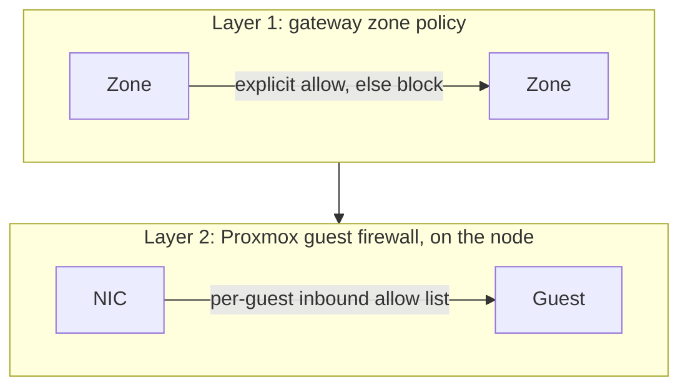

# Network and trust zones

## Zones

| Zone | VLAN | Network | Holds | Trust |
|---|---|---|---|---|
| External | | WAN | Internet | None |
| DMZ | 125 | `__DMZ_NET__.0/24` | `edge01` | Low: internet-facing |
| Services | 120 | `__SVC_NET__.0/24` | Applications | Medium |
| Security | 110 | `__SEC_NET__.0/24` | `siem01` | High: restricted admin access |
| Management | 100 | `__MGMT_NET__.0/24` | Nodes, platform tier, backups, PAW | Highest |
| Storage | 130 | `__STOR_NET__.0/24` | NFS, not routed for clients | Single purpose |
| Internal | | `__LAN_NET__.0/24` | Workstations, user devices | Client |
| Isolated | SDN | `__KALI_NET__.0/24` | `kali01` | Untrusted, internet only |

## Two enforcement layers

| Layer | Source of truth | Filters | Why it exists |
|---|---|---|---|
| Zone policy | `ansible/network/zone_policy.yml` | Inter-zone and outbound | Coarse boundaries |
| Guest firewall | `tofu/envs/prod/firewall.tf`, `tofu/platform/prod/firewall.tf` | Inbound to each guest, including same-VLAN | Root in a guest and Docker's iptables cannot disable it |
| Application | `pg_hba`, Caddy `lan_paths`, OpenBao bindings | Per identity or path | Defense in depth |

Rationale: [ADR-0007](../adr/0007-zone-segmentation-and-guest-firewalls.md).

## Inbound paths

| Path | Port | Destination | Purpose |
|---|---|---|---|
| WAN forward | TCP 443 | `edge01` | Every public web name |
| WAN forward | UDP 41641, 41642 | `ts01`, `ts02` | Direct WireGuard paths |

Git SSH (port 2222), SMB, and admin interfaces are never forwarded.

## Exposure per site

Caddy decides what outside addresses may reach (`inventories/common/group_vars/caddy.yml`).

| Site | From the internet | Internal only |
|---|---|---|
| `auth` | Sign-in with MFA and reputation lockout | `/if/admin/*`, `/api/v3/admin/*` |
| `git` | Public repositories, SSO sign-in | Sign-up, admin, admin API |
| `cloud`, `office` | Web and sync clients, editor | Admin settings, Collabora console |
| `media` | SSO and Quick Connect only | Password login, reset, setup wizard, SAML |
| `music` | Forward auth; app passwords for Subsonic | |
| `books` | OIDC handled by the application | |
| `vault` | Clients and sign-in | `/admin` |
| `hs` | Coordination (devices must reach it to join) | |
| `mdm` | Only MDM check-in, SCEP and enrollment paths | Console and API |
| `sync` and others | 403 | Everything |

An overlay client arrives through `ts01` with a LAN source address, so internal-only paths work from a
trusted device with no extra rules.

## Admin paths

Only two controllers may reach management: the admin workstation and `paw01`. Their addresses appear in
`unifi_workstation` and `unifi_paw` in `zone_policy.yml` and in `lab_controllers`. `roles/postgres` fails a run
if the two lists differ.

| From | To | Port | Identity |
|---|---|---|---|
| Controllers | All hosts | 22 | SSH certificate |
| Controllers | `pg01` | 5432 | SCRAM, TLS verify-full |
| Controllers | `bao01` | 8200 | X.509 certificate or AppRole |
| Controllers | `ca01` | 443, 8443 | JWK provisioner, OIDC |
| Hosts | `ca01` | None | The controller signs and pushes host certificates |
| All agents | `siem01` | 1514-1515 | Wazuh agent |

## DNS

Local names are generated from the inventories by `playbooks/unifi_dns.yml`. Public names are CNAMEs to a
dynamic WAN name. On the LAN that name resolves to `edge01`, which gives split-horizon DNS without hairpin NAT.
