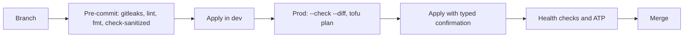

# Architecture overview

## Purpose and scope

The platform provides identity, source control, file sync, password management, device management, mail
aggregation, media, and local AI services for a small group of users. It is deliberately operated with
enterprise practices so that the patterns transfer to production environments.

**Design principles**

1. **Everything as code.** Every network rule, guest, role and identity object is in git. Console-only settings are listed where they exist.
2. **Least privilege by default.** Default-deny between zones, per-guest allow lists, narrow machine identities.
3. **Short-lived credentials.** Certificates measured in hours replace standing keys.
4. **Assume breach.** Enforcement sits outside the thing it protects, logs leave the host, and recovery does not depend on the failed tier.
5. **Prove it.** A control counts when an [acceptance test](../atp/README.md) passes and a backup counts when it restores.
6. **State the gaps.** Known limitations are written down in the ADRs and the [control mapping](../compliance/README.md).

## Layers

Nothing in a layer works until the layers above it are running. This is also the recovery order.

| # | Layer | Components | Depends on |
|---|---|---|---|
| 1 | Network | Gateway, switches, VLANs, zone policy, local DNS | Power |
| 2 | Compute | Proxmox cluster `pve01`-`pve03` (quorum 2 of 3), ZFS pool `tank` on `pve03` | 1 |
| 3 | Platform | `pg01` state and storage, then `bao01` secrets, then `ca01` certificates | 2 |
| 4 | Backup | `pbs01`, datastore on `tank` over NFS | 2, 3 |
| 5 | Edge and identity | `edge01`, `idp01`, then `hs01`, `ts01`, `ts02` | 3 |
| 6 | Services | `git01`, `pw01`, `mdm01`, `mail01`, `cloud01`, `media01`, `files01`, `sync01`, `ai01` | 5 |
| 7 | Observability | `siem01` (nothing depends on it) | 2 |
| 8 | Lab | `labnode`: `paw01`, `gpu01`, `kali01`, nested `pvedev1`-`3` | 3 |

## Inventory

| Host | Zone | Type | Role | Node |
|---|---|---|---|---|
| `edge01` | DMZ | VM | Caddy reverse proxy, the only inbound path | `pve01` |
| `idp01` | Services | VM | Authentik: OIDC, SAML, LDAP outposts, MFA | `pve01` |
| `git01` | Services | VM | Forgejo | `pve01` |
| `pw01` | Services | VM | Vaultwarden | `pve01` |
| `mdm01` | Services | VM | Fleet MDM | `pve01` |
| `siem01` | Security | VM | Wazuh manager, indexer, dashboard | `pve01` |
| `pg01` | Management | LXC | PostgreSQL: OpenTofu state, OpenBao, step-ca | `pve02` |
| `bao01` | Management | LXC | OpenBao | `pve02` |
| `ca01` | Management | LXC | step-ca (automation and people instances) | `pve02` |
| `pbs01` | Management | VM | Proxmox Backup Server | `pve02` |
| `cloud01` | Services | VM | Nextcloud and Collabora | `pve02` |
| `ai01` | Services | LXC | AI application host | `pve02` |
| `hs01` | Services | LXC | Headscale coordination | `pve03` |
| `ts01`, `ts02` | Services | LXC | Subnet router, exit node | `pve03` |
| `mail01` | Services | LXC | Stalwart and mailbox sync | `pve03` |
| `media01`, `sync01`, `files01` | Services | LXC | Media apps, Syncthing, Samba | `pve03` |
| `paw01` | Management | VM | Admin workstation, second controller | `labnode` |
| `gpu01` | Services | VM | Ollama, pgvector | `labnode` |
| `kali01` | Isolated | VM | Security testing, internet only | `labnode` |

## Environments

| Environment | Purpose | Platform tier | Network |
|---|---|---|---|
| `prod` | Production | Its own | VLANs and zone policy |
| `labnode` | Admin workstation, GPU, test hosts | Shares prod's | Prod VLANs and private SDN |
| `dev` | Pre-production proof of change | Its own | Flat NAT network |

| Layer | Shared across environments | Per environment |
|---|---|---|
| Ansible | `roles/`, `inventories/common/` | `inventories/<env>/` |
| OpenTofu (Proxmox) | `modules/service_vm`, `modules/service_lxc` | `envs/<env>` |
| OpenTofu (identity) | `modules/authentik_config` | `authentik/<env>` |

`bin/ap` loads `inventories/common` first and then the environment, so an environment value always wins.
Plays target role groups rather than host names, so moving a service changes only the inventory.

## Change flow

Renovate proposes dependency updates as pull requests. It never deploys. See
[Patching](../runbooks/patching.md).

## Known limitations

| Limitation | Effect | Plan |
|---|---|---|
| Backups share a pool with the data | A lost pool loses bulk data and guest backups | Offsite PBS sync and ZFS replication ([ADR-0011](../adr/0011-backup-strategy.md)) |
| `pve03` is a single point for bulk data | Its failure stops storage-backed services | Same |
| No HA: guests live on node-local disks | A node failure means restoring from PBS | Accepted |
| The CA runs on an LXC with software keys | Host root compromise exposes online CA keys | Move to a TPM-backed VM or a hardware-backed root |
| Internal hops behind Caddy are HTTP | Traffic in the Services zone is cleartext | Issue backend certificates from `ca01` |

## Related

- [Network and trust zones](network-and-trust-zones.md)
- [Identity, secrets and PKI](identity-secrets-pki.md)
