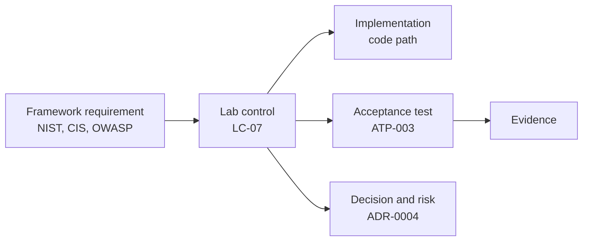

# Compliance mapping

This maps the platform's controls to common security frameworks, so that a reviewer can trace a requirement to the code that implements it and the test that proves it.

> **This is a self-assessment of a small private environment, not a certification or audit.** Many enterprise requirements (policy, staff training, vendor management) are out of proportion here and are marked as such. Status reflects the configuration in this repository.

## How it fits together

| Document | Framework |
|---|---|
| [Control catalog](control-catalog.md) | **Start here:** every lab control, with its status, code and test |
| [NIST CSF 2.0](nist-csf-2.0.md) | Cybersecurity Framework 2.0, by function and category |
| [NIST SP 800-53 Rev. 5](nist-800-53.md) | Security and privacy controls, by family |
| [NIST SP 800-207](nist-800-207.md) | Zero trust tenets |
| [CIS Controls v8.1](cis-controls.md) | The 18 Critical Security Controls |
| [Top 10 lists](top-10-lists.md) | OWASP Top 10:2025, API 2023, Docker, Non-Human Identities, LLM 2025; NSA/CISA misconfigurations |
| [CIS Debian 13 exceptions](cis-debian13-exceptions.md) | Benchmark items fixed, compensated or accepted |
| [Gap register](gap-register.md) | Open gaps with risk and plan |

## Status definitions

| Status | Meaning |
|---|---|
| **Implemented** | Configured in this repository and in effect by default |
| **Partial** | Present but staged, limited in scope, or with a material stated gap |
| **Planned** | Designed or documented, not built |
| **Gap** | Not addressed |
| **N/A** | Out of proportion to, or not applicable in, this environment |

## Summary

| Status | Lab controls |
|---|---|
| Implemented | 26 |
| Partial | 10 |

The three switches behind several Partial ratings are in [Rollout states](../architecture/identity-secrets-pki.md#rollout-states). Turning them on moves LC-02, LC-08 and LC-12 to Implemented, once the matching ATP passes.

## Top priorities from this assessment

1. **Off-site backups** (G-01): the largest risk.
2. **Enforce guest firewalls** (G-02): audit mode detects lateral movement, but does not stop it.
3. **Outbound alert delivery** (G-03): alerts currently wait for a person to look.
4. **Container hardening** (G-05) and **edge security headers** (G-06): cheap, and they close common findings.

## Sources

- [NIST CSF 2.0](https://www.nist.gov/cyberframework)
- [NIST SP 800-53 Rev. 5](https://csrc.nist.gov/pubs/sp/800/53/r5/upd1/final)
- [NIST SP 800-207](https://csrc.nist.gov/pubs/sp/800/207/final)
- [CIS Critical Security Controls](https://www.cisecurity.org/controls)
- [OWASP Top 10:2025](https://owasp.org/Top10/2025/)
- [OWASP API Security Top 10](https://owasp.org/API-Security/)
- [OWASP Docker Top 10](https://owasp.org/www-project-docker-top-10/)
- [OWASP Non-Human Identities Top 10](https://owasp.org/www-project-non-human-identities-top-10/)
- [OWASP Top 10 for LLM Applications](https://genai.owasp.org/)
- [NSA/CISA Top Ten Cybersecurity Misconfigurations, AA23-278A](https://www.cisa.gov/news-events/cybersecurity-advisories/aa23-278a)
