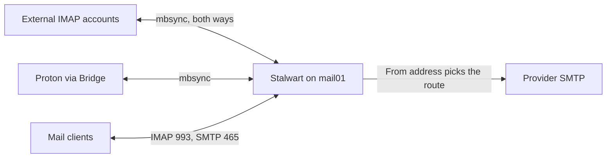

# Run the mail hub

**Goal:** Give each person one mailbox on an internal server, with external accounts synced in both directions and mail sent through the account it is from.

**Why:** [ADR-0013](../adr/0013-mail-hub-and-public-edge.md). External providers stay the source of truth.

| Piece | Location |
|---|---|
| Container | `mail01`, LXC 4261 |
| Server | Stalwart: IMAP 993, submission 465, portal HTTPS 443 |
| Sync | `mbsync`, one systemd timer per person, every 3 minutes |
| Proton | Proton Bridge, loopback only, signed in once by hand |
| Name | `mail.example.com`, local DNS and VPN split DNS; certificate from `ca01` |
| Reach | LAN and VPN only |
| Secrets | OpenBao `kv/services/prod/mail` |

## How it works



- **Merged folders.** Each account's Inbox, Sent, Trash and Spam land in the mailbox's own folders. Reading, flagging or deleting reaches the source account. **Emptying Deleted Items deletes at the provider for good.** A message moved *into* one of these folders stays local, since the sync never uploads one account's mail into another.
- **Labels** stay under each account's folder, both ways. A whole folder is never deleted by the sync.
- **Sending.** Stalwart relays with that account's credentials, so SPF and DKIM are the provider's. Each person can send only as their own addresses.
- **Mailbox domain.** `lan.example.com` is an internal login domain, never in public DNS, and cannot send externally. Do not use a domain whose mail is hosted elsewhere as `mail_domain`: Stalwart would deliver that domain's mail locally.

## Deploy

1. **Secrets.**
   ```bash
   bin/gen-service-secrets prod
   ```
2. **Container and firewalls.**
   ```bash
   bin/tf prod plan && bin/tf prod apply
   ```
   ```bash
   bin/ap prod playbooks/unifi_firewall.yml
   ```
   ```bash
   bin/ap prod playbooks/platform.yml --limit step_ca
   ```
   ```bash
   bin/ap prod playbooks/unifi_dns.yml
   ```
3. **Configure.** With no accounts yet, mailboxes exist and nothing syncs.
   ```bash
   bin/ap prod playbooks/services.yml --limit mail01 -e ansible_user=root
   ```
   ```bash
   bin/ap prod playbooks/services.yml --limit mail01
   ```
   ```bash
   bin/ap prod playbooks/services.yml --limit hs01
   ```

## Add an account

List it first. An account participates once its secrets exist.

```yaml
mail_users:
  - name: alice
    accounts:
      - { id: alice_gmail1, type: gmail, folder: Gmail }
```

**Gmail.** Turn on 2-Step Verification and create an app password. In Gmail settings set expunge to *Immediately delete the message forever*. First sync of a large account takes hours to days, because Gmail limits IMAP downloads per day.

```bash
bin/bao-secret prod set mail_alice_gmail1_address
```
```bash
bin/bao-secret prod set mail_alice_gmail1_password
```
```bash
bin/ap prod playbooks/services.yml --limit mail01
```

**Proton.** Requires a paid plan. Sign Bridge in once on `mail01`:

```bash
sudo systemctl stop protonbridge
```
```bash
sudo -u protonbridge -H protonmail-bridge --cli
```

In the CLI: `login`, `info` (copy the Bridge password), `cert export` to `/var/lib/protonbridge/tls`, `updates autoupdates disable`, `exit`. Start the service, store the address and **Bridge** password as above, and run the play. List extra send-as addresses comma-separated in `mail_alice_proton_send_as`: they stay in OpenBao, not this repository.

## Configure clients

| Setting | Value |
|---|---|
| Incoming | IMAP, `mail.example.com`, 993, SSL/TLS |
| Outgoing | SMTP, `mail.example.com`, 465, SSL/TLS |
| Username | `alice` |
| Password | An app password from the portal, one per device |

Copy the main password without displaying it, and leave it alone afterward. Do **not** enable two-factor on this account: the sync logs in with the main password.

```bash
bin/bao-secret prod copy mail_user_alice_password
```

Each device must trust the root: the MDM profile on iOS, the [system store](admin-ui-tls.md) elsewhere. Add each address as a sending identity.

## Verify

```bash
ssh ansible@mail01 'sudo systemctl status stalwart protonbridge mailsync@alice.timer --no-pager'
```
```bash
openssl s_client -connect mail.example.com:993 -CAfile ansible/files/prod/ca01-root.pem </dev/null | grep Verify
```

Sending from the internal address to an external one must report "Relay not allowed".

## Maintain

| Task | Action |
|---|---|
| New person | Entry in `mail_users`, password in `bin/gen-service-secrets`, run the play |
| Remove an account | Delete from `mail_users`, run the play, `bin/bao-secret prod unset` its secrets |
| Authentication failed | New app password; for Proton, sign Bridge in again |
| Force sync | `sudo systemctl start mailsync@alice` |
| Upgrade | Version and sha256 together; PBS is the rollback |

## Recover

- **`mail01` lost:** restore from PBS. If rebuilt empty, nothing is lost while providers are the source of truth; sign Bridge in again.
- **Start the store over:** **stop the sync first and clear its state.** `mbsync` compares against what it saw last and would read an empty mailbox as "everything was deleted" and propagate that.

  ```bash
  ssh ansible@mail01 'sudo systemctl stop "mailsync@*.timer" "mailsync@*.service" stalwart && sudo find /var/lib/mailsync -mindepth 2 -delete && sudo find /var/lib/stalwart -mindepth 1 -delete'
  ```
  ```bash
  bin/ap prod playbooks/services.yml --limit mail01
  ```
