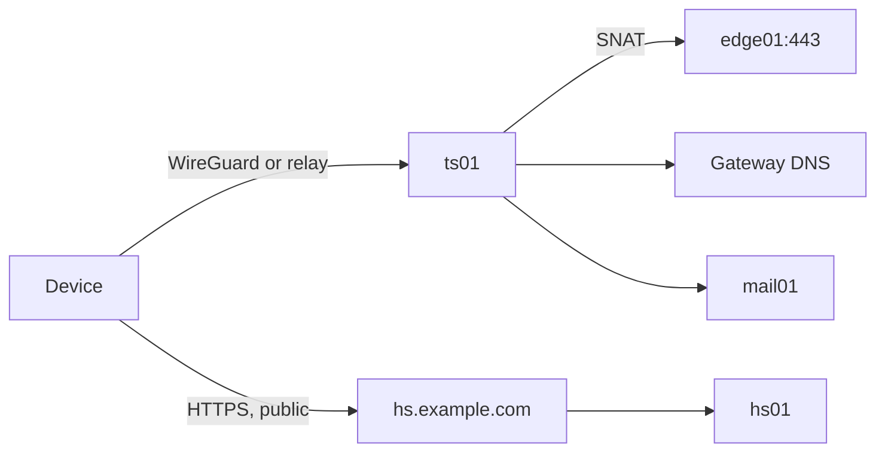

# Set up remote access

**Goal:** Give trusted devices access to private services through a split-tunnel WireGuard overlay.

**Why:** [ADR-0009](../adr/0009-split-tunnel-overlay-vpn.md). **Accept with:** [ATP-007](../atp/ATP-007-remote-access.md).

| Piece | Location |
|---|---|
| Coordination | `hs01`, `roles/headscale`, `https://hs.example.com` |
| Subnet router | `ts01`, `roles/tailscale_router`, `tag:router` |
| Exit node | `ts02`, same role, `tag:exit`, per-device grant |
| WAN | UDP 41641 to `ts01`, 41642 to `ts02` |
| Settings | `inventories/common/group_vars/headscale.yml` |
| Sign-in | Authentik OIDC, group `headscale-users` |
| Relays | Tailscale's public DERP servers, used only when no direct path exists; end-to-end encrypted |

## How it works



- **Coordination is not data.** `hs01` hands out keys, routes and DNS settings, and traffic never passes through it.
- **Split tunnel.** `ts01` advertises only `/32` routes.
- **Split DNS.** Only lab names resolve through the tunnel. `hs.example.com` is left out on purpose, because a device must reach it outside the tunnel.
- **Source address.** `ts01` masquerades, so internal-only paths work and the zone policy allows just one address.
- **Device trust.** Signing in is not enough; the device needs an entry in `headscale_trusted_devices`.
- **Key expiry.** Device keys expire after 180 days. Tagged routers do not.

## Roll out

1. **Identity.** Add people to `headscale-users`; usernames must match `headscale_users`.
   ```bash
   bin/tf-ak prod plan && bin/tf-ak prod apply
   ```
2. **Containers and firewalls.**
   ```bash
   bin/tf prod plan && bin/tf prod apply
   ```
   ```bash
   bin/ap prod playbooks/unifi_firewall.yml
   ```
   ```bash
   bin/ap prod playbooks/platform.yml --limit step_ca
   ```
   ```bash
   bin/ap prod playbooks/lxc_host.yml --limit pve03
   ```
3. **Edge and DNS,** before the routers, since they reach Headscale by name. Add a public `hs` CNAME.
   ```bash
   bin/ap prod playbooks/services.yml --limit caddy
   ```
   ```bash
   bin/ap prod playbooks/unifi_dns.yml
   ```
4. **Configure.** The first run is as root. `hs01`'s play ends with "Authentik sign-in is on". `ts01` joins with a single-use key that is valid for 10 minutes and never printed.
   ```bash
   bin/ap prod playbooks/services.yml --limit hs01,ts01,ts02 -e ansible_user=root
   ```
   ```bash
   bin/ap prod playbooks/services.yml --limit hs01,ts01,ts02
   ```
5. **Check from outside:** `https://hs.example.com/health` returns `{"status":"pass"}`.

## Enroll a client

Use the official Tailscale app (1.80 or newer). The only difference from the hosted service is the server URL, `https://hs.example.com`.

| Platform | How |
|---|---|
| iOS, iPadOS | MDM-enrolled: profile and `bin/mdm-tailscale` handle it. Otherwise app settings, *Use custom coordination server*, then log in, and turn on VPN On Demand |
| macOS | Profile from `https://hs.example.com/apple`, or the command below |
| Windows | `tailscale login --login-server https://hs.example.com`; check *Use Tailscale subnets* and *DNS settings* |
| Linux | `sudo tailscale up --login-server https://hs.example.com --accept-routes --operator="$USER"` |
| Android | Menu, *Change server*; Always-on VPN on, but **not** *Block connections without VPN* |

```bash
/Applications/Tailscale.app/Contents/MacOS/Tailscale login --login-server https://hs.example.com
```

Authentik opens in a browser. The device then reaches nothing until trusted.

## Trust a device

Trust is a decision per device, after checking it is yours, updated, and screen-locked. Every grant is a reviewed commit.

```bash
ssh ansible@hs01 'sudo headscale nodes list'
```
```bash
bin/vpn-trust alice-phone
```
```bash
bin/ap prod playbooks/services.yml --limit hs01
```

Commit `headscale.yml`. `--exit home` also grants the exit node. The play ends with "Rejected devices", which should read `none`. Remove a device's line **before** deleting it in Headscale.

This trusts the device you checked, not its current state.

## Use the exit node on untrusted networks

Add the device to `headscale_exits.home.devices` and run the `hs01` play. Then choose exit node `ts02` in the app on untrusted Wi-Fi, and *None* otherwise. Lab traffic still uses `ts01`.

**Roaming media device:** the same mechanism serves a TV stick for travel.

- Sideload the universal Android APK. Fire OS works; Vega OS does not.
- Point it at the server.
- Trust it, rename it, and disable key expiry so it never needs sign-in on the road: `headscale nodes expire -i <ID> --disable`.
- Connect to the captive portal *before* switching the tunnel on.
- Cap the bitrate in the player, because all traffic uses the site's upload.

If it is lost, expire and delete it at once, since it never expires by itself.

## Access from an unmanaged machine

Do not install the client; it would be rejected. Use public media sites: Jellyfin Quick Connect, approved from your phone so no password is typed there, or Authentik in a private window. Afterward, end the session in Authentik.

## Add a destination

Three places must agree:

1. `headscale_routes`
2. `headscale_acls`
3. Zone policy for `ts01`, plus the destination's guest firewall

Prefer putting a web UI behind Caddy as an internal-only site, which needs no new route.

## Reduce public exposure in phases

| Phase | Action | Done when |
|---|---|---|
| 0 | Roll out; sites unchanged | An internal-only site works from cellular through the tunnel |
| 1 | Enroll all devices | A week of normal use away with the tunnel on |
| 2 | Set `public: false` on sites only your devices use | They answer with the tunnel on, and not without |
| 3 | Remove those public DNS names | A public resolver returns nothing |

Keep `auth` and `hs` public in every phase. `vault` is the first candidate. Sites used by devices that cannot run a client, or by external share links, stay public.

## Verify

```bash
ssh ansible@hs01 'sudo headscale nodes list-routes'
```
```bash
tailscale ping ts01
```
```bash
dig +short auth.example.com
```

From a client away from the site, `auth` resolves to `edge01`'s internal address, and `hs` resolves to the public address.

## Maintain

| Task | Action |
|---|---|
| New person | Add to `headscale_users` and the group; run the `hs01` play |
| Lost device | Expire it, remove its line, run the play, delete it. Sign it out of Authentik and apps |
| Headscale upgrade | One minor version at a time; change version and sha256 together; the night's PBS backup is the rollback |
| Router patching | `bin/ap prod playbooks/patch.yml --limit ts01,ts02` |

Removing someone from the group stops new sign-ins but not joined devices: expire those too.

## Failure modes

| Failure | Effect | Recovery |
|---|---|---|
| `ts01` down | No tunnel in; public sites work | Restore from PBS; it rejoins by itself |
| `hs01` down | Existing tunnels keep working for a while; nothing new joins | Restore from PBS. Rebuilt empty means re-enroll and rewrite the trusted list |
| Authentik down | `hs01` refuses to start; a running one serves joined devices | Fix `idp01` first |
| `edge01` down | Nothing joins and the tunnel has nothing to reach | Restore `edge01` |
| VPN broken while sites are private | No way in from outside, by design | Offline app copies; keep another path before long absences |
